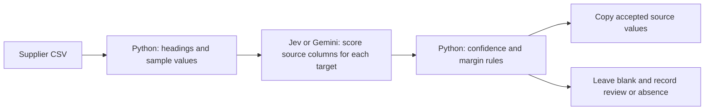

# Supplier CSV column mapping: Jev vs Gemini

A Python prototype that maps differently named supplier CSV columns into one
stable schema. Python reads files, applies acceptance rules, and copies values;
Jev or Gemini supplies scores for the candidate source columns.

This repository includes synthetic supplier data, the mapping code, an offline
test suite, and evidence from a small live comparison of **Jev 1.14** and
**Gemini 3.8 Flash through OpenRouter**. It is a development experiment, not a
general model leaderboard or a production reliability claim.

## Latest measured comparison

**November 3, 2026:** 10 synthetic CSVs, 100 product rows each. Each model handled
all seven target fields in every file: 70 mapping tasks per model. Five target
fields were absent, leaving 65 tasks with an expected source column. Mapping is
column-level: 1,000 product rows are not 1,000 independent AI decisions.

| Metric | Jev 1.14 | Gemini 3.8 Flash |
| --- | ---: | ---: |
| Expected source column ranked uniquely first | 65/65 | 65/65 |
| Expected mapping/absence decisions | 69/70 | 70/70 |
| Incorrect accepted mappings | 0 | 0 |
| Median successful API response | 0.224 s | 3.514 s |
| P95 successful API response | 0.519 s | 7.536 s |
| Known cost for the whole 10-file trial | $0.003770424 | $0.10337775 |
| Successful responses / attempted calls | 70/70 | 70/71 |

In this trial, Jev had approximately **16x lower median response time** and
**27x lower known cost**. Timings include networking and response decoding.
Gemini costs were reported by OpenRouter; Jev costs were calculated from billable
input tokens and the published $0.042 per million input-token rate. The charge
for one timed-out Gemini attempt is unknown and is not included in the known
cost total. This is not a fully verified billing comparison.

### The useful review outcome

In the description-only specifications case, Jev ranked the correct Description
column first but assigned it a score of **0.75**. Our unchanged acceptance rule
requires at least **0.85** and a **0.15** margin over the runner-up, so Python
held the mapping for review and left the output blank. Gemini accepted it.

This is a difference in automatic completion, not a wrong source-column choice.
It illustrates why a review path can be useful; it does not establish confidence
calibration or prove that one model is universally safer.

Read the [complete findings and input/output links](output/model_comparison/20261103T180933Z_00fa90/FINDINGS.md),
[per-task evidence](output/model_comparison/20261103T180933Z_00fa90/results.json),
and [summary CSV](output/model_comparison/20261103T180933Z_00fa90/summary.csv).

## Workflow



The eight output columns are:

```text
supplier,supplier_product_id,model_number,product_name,category,price_usd,stock_quantity,specifications
```

Python derives `supplier` from the filename. The seven remaining fields are
mapped using model scores. The comparison preserves raw CSV strings, including
leading-zero IDs, zero stock, and blank values. The original `jev.py` is retained
as the prototype baseline and still uses pandas type inference; the comparison
adapter's raw-string handling should not be confused with that baseline.

## Setup

Python 3.11+ and your own API credentials are required for live runs.

```bash
python -m venv .venv
# Activate .venv for your shell, then:
python -m pip install -r requirements.txt
```

Copy `.env.example` to `.env.openrouter` and fill the keys locally:

```dotenv
OPENROUTER_API_KEY=
TYPESAFE_API_KEY=
```

Alternatively, `python testing/comparison/set_key.py` provides masked OpenRouter
key entry. Local key files are ignored by Git. Never put credentials in commits,
screenshots, issues, or public posts. A non-empty local key takes precedence over
an inherited environment variable.

## Run the comparison

The command below plans the ten-file, two-model test **without inference**:

```bash
python testing/comparison/compare_models.py --model jev-1.14.0 --model google/gemini-3.8-flash --case 01_clean_synonyms --case 02_shuffled_distractors --case 03_missing_fields --case 04_description_has_specs --case 06_eur_only --case 07_usd_box_prices --case 08_quantity_traps --case 13_zero_and_blank_stock --case 14_leading_zero_ids --case 17_multilingual_headings
```

Add `--run` to make paid calls. Use `--max-usd 1` for the local estimated spend
guard. The guard is not a provider-enforced billing cap; set a credit limit on
your key if you need an account-side cap. API requests have output limits and no
automatic retries. New runs save to new folders, preserving the published run.

Each repeated `--case` selects all seven target fields for that CSV. Without
`--case`, the runner uses a smaller mixed task selection. Without `--model`, it
uses the enabled models in `testing/comparison/models.json`; choose models
explicitly when controlling costs.

See the [comparison guide](testing/comparison/README.md) for model configuration,
metrics, reasoning settings, recovery, and cost accounting, and the
[fixture guide](testing/README.md) for all 25 synthetic stress cases.

## Offline checks

```bash
python -m unittest discover -s testing/comparison -p test_compare_models.py -v
```

These checks use explicitly mocked adapter responses. They validate scoring,
missing/error handling, credential precedence, output copying, and selective
recovery; they do not call paid models or constitute model benchmark results.

## Scope and limitations

- This is one run on previously seen development fixtures, not an unseen test set.
- Both models receive the same core state/questions. Jev returns native typed
  probabilities; Gemini needs extra JSON output instructions and can attend to
  the question bundle. Chat scores are not assumed to share Jev's calibration.
- Only the first eight non-empty values per column are sampled. Whole-file data
  validation and broader sampling remain separate work.
- The field definitions retain prototype-specific wording, including a
  filename-specific price assumption. Do not reuse that assumption on unknown
  supplier files without checking their currency and unit basis.
- One Gemini request timed out at 45 seconds. Explicit recovery completed only
  failed or unrun tasks using a 90-second network timeout, without repeating
  successful work. The failed attempt remains in the evidence.
- All 20 final output CSVs were checked for expected row counts and exact copied
  values. A blank can mean missing, uncertain, or unrun; inspect the mapping audit.
- No general zero-hallucination claim is made. Ranking accuracy, acceptance,
  abstention, parsing, and value preservation are distinct measurements.

The published evidence omits service request/generation identifiers and local
attempt-history archives. Scores, token usage, known costs, timing records, and
the timeout are retained. Local credentials and backups are not distributed.

## References

- [TypeSafe model versions and pricing](https://docs.typesafe.ai/models)
- [OpenRouter model catalog](https://openrouter.ai/api/v1/models)
- [OpenRouter structured outputs](https://openrouter.ai/docs/guides/features/structured-outputs)
- [OpenRouter usage accounting](https://openrouter.ai/docs/cookbook/administration/usage-accounting)
